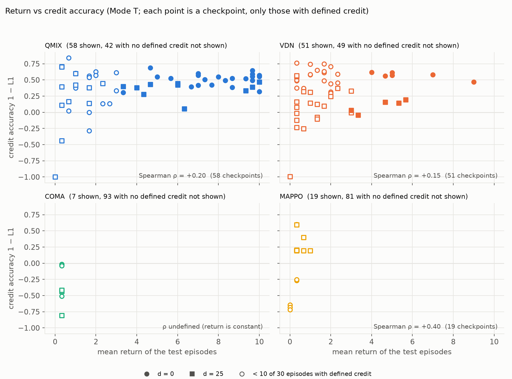

# Mode T (H4): Return vs Credit Faithfulness

**Status: H4 assessed descriptively for two methods (VDN and QMIX) under a seeded protocol; COMA and MAPPO were tried with behavioural-cloning pretraining but collapse online, so they could not be assessed (§3b).** Plain online training never earned reward (§1). Seeding the replay buffer with scripted episodes fixed that for the two off-policy learners (§2), which allowed a return-versus-credit analysis (§3).

## 1. Plain online training earns no reward

`scripts/run_mode_t.py train` runs one EPyMARL run per method, delay and seed on `coalition_layout` (b = 2, horizon 60), CPU only. Delay 0, seed 0 throughout:

| run | steps | wall time | test return |
|---|---|---|---|
| MAPPO | 400,000 | 3.6 min | 0 at all 19 evaluations |
| QMIX | 400,000 | 7 min | 0 at all 19 evaluations |
| QMIX | 1,000,000 | 16 min | 0 at all 19 evaluations |

No training or test episode completed the event. The cause is exploration: a uniform-random policy earned reward in **0 of 20,000 episodes** (upper 95% bound about 1.5 × 10⁻⁴ per episode), so the critics never see a reward. This does not depend on the credit question. Logs: `results/mode_t/check_400k/`, `results/mode_t/check_1M/`. The runs needed a Python 3.12 environment (`.venv312`): `sacred 0.8.7` does not import under 3.14, which the Mode P, H3 and H5 runs used. Mode P results are unaffected.

## 2. Seeding the replay buffer

`scripts/run_epymarl_seeded.py` reuses `run_epymarl.py` and swaps in a replay buffer that starts with **200 scripted full-team episodes** (ε = 0.2, mean return 10; seeds disjoint from Mode P's), converted by `whoearned.epymarl_bridge.episodes_to_batch`. EPyMARL is unmodified. The buffer holds 20,000 episodes so the seeded ones are not overwritten. Training then proceeds online as usual (ε annealed from 1.0 to 0.05 over 50k steps).

**This only works for VDN and QMIX.** COMA and MAPPO are on-policy and clear their buffer after each update, so seeding does nothing for them; they are handled separately in §3b.

**Design.** VDN and QMIX × delay ∈ {0, 25} × 5 seeds = 20 runs, 400,000 steps each, a checkpoint every 40,000 steps (the last saved is at t = 360,240). The 19 new runs took 27 minutes on 8 workers; each run alone takes about 7 minutes. Evaluation of all checkpoints took under two minutes.

**Learning.** Seeding makes the task learnable but unevenly. Mean test return at the final checkpoint, under the ε = 0.2 behaviour used to score credit (30 episodes; the maximum is 10):

| method | d = 0 | d = 25 | seeds that never leave 0 |
|---|---|---|---|
| QMIX | 8.5 | 4.4 | 2 of 10 (both d = 25) |
| VDN | 3.7 | 2.4 | 2 of 10 (one at each delay) |

Return varies widely across runs and checkpoints, and for VDN it sometimes falls after rising (one run reached 10 and later returned to 0). That variation is what H4 needs.

## 3. H4 analysis (descriptive)

Code: `scripts/analyse_h4.py` → `results/mode_t/h4_analysis.md`. The problem statement gives no thresholds for "weakly", "strongly" or "statistically indistinguishable", so we fixed them **before scoring any checkpoint**; they are our own choices, not pre-registered: correlation is *strong* if the 95% CI of Spearman ρ lies above 0.7 and *weak* if the point estimate is below 0.3; "indistinguishable return" means a two-sided paired t-test over runs with p > 0.05; "differ in L1" means p < 0.05. The unit is a checkpoint; confidence intervals resample whole runs (delay × seed), because checkpoints within a run are dependent.

Credit is scored as in Mode P: the method's own read-out on 30 test episodes (the trained policy with ε = 0.2 noise), against leave-one-out from open-loop removal. It is undefined for an episode whose true values sum to zero, so a checkpoint with no such episode has no L1 and is excluded.

**Within each method, return is only weakly correlated with credit accuracy (1 − L1).**

| method | checkpoints used (of 100) | Spearman ρ | 95% CI | reading |
|---|---|---|---|---|
| QMIX | 58 | +0.20 | [−0.12, +0.47] | weak |
| VDN | 51 | +0.15 | [−0.18, +0.34] | weak |

No CI reaches 0.7, so return does **not** strongly predict credit accuracy. Split by delay the estimates are −0.05 to +0.20, with wide intervals. Keeping only checkpoints with at least 10 of 30 episodes with defined credit gives QMIX ρ = +0.29 (CI [+0.03, +0.59], 32 checkpoints) and VDN ρ = +0.30 (CI [−0.42, +0.96], only 11 checkpoints, so uninformative).

**Two methods with indistinguishable return differing in L1: not shown.** Over the 10 paired runs (QMIX vs VDN), QMIX's return is significantly higher (6.5 vs 3.1 at the last checkpoint with defined credit; p = 0.013; and 6.5 vs 2.4 over checkpoints at t ≥ 240k, p = 0.002) while L1 hardly differs (0.64 vs 0.75, p = 0.44; 0.57 vs 0.60, p = 0.51). The pattern is the reverse of what that clause describes, so the clause is not met, although "QMIX earns far more yet assigns credit no more accurately" points the same way as H4's spirit.

**Post-hoc: learned credit vs uniform credit.** This places the Mode T L1 values on the Mode P scale. It is not part of H4. Uniform credit (1/n per agent) is scored on the same valid episodes as the method, at the last checkpoint with defined credit in each run (`h4_analysis.md`, last section):

| method | L1 (method) | L1 (uniform) | runs where method < uniform | exact Wilcoxon p |
|---|---|---|---|---|
| QMIX | 0.637 | 0.790 | 7/10 | 0.020 |
| VDN | 0.747 | 0.683 | 4/10 | 0.43 |

- QMIX's online-trained credit carries some information beyond an equal split. In Mode P, by contrast, methods beat uniform in only 5 of 96 main-grid conditions.
- VDN's online-trained credit does not.
- This is exploratory: one comparison per method, chosen after seeing the H4 results, and no multiplicity correction.

**Verdict for H4 (descriptive, not confirmatory).** The first clause (return is a weak proxy) is consistent with the data for both methods, and its falsifying condition (return strongly predicts credit) is not met. The second clause is not demonstrated. H4 is therefore neither falsified nor confirmed; the evidence is mildly supportive of the first part.

## 3b. COMA and MAPPO: behavioural-cloning pretraining

Code: `scripts/run_epymarl_bc.py` (EPyMARL stays unmodified; it patches the learner registry and replay buffer). Before the first online step the learner is initialised from **400 scripted full-team episodes** (ε = 0, so the cloned actor is near-deterministic):
1. the shared actor is cloned with cross-entropy (200 epochs, Adam lr 1e-3; the action NLL falls from 1.5 to 0.54);
2. the critic is warmed up by running the learner's own `train` 1,000 times with the actor's learning rate set to 0, so only the critic, its target and the reward normaliser learn;
3. online training then runs with EPyMARL's default hyperparameters, 400,000 steps, as for VDN and QMIX.

Design: COMA and MAPPO × delay ∈ {0, 25} × 5 seeds = 20 runs (`scripts/run_mode_t.py train --algs=coma,mappo --bc-episodes 400`; 57 minutes on 4 workers). The BC settings were chosen from four 60k-step smoke runs (three COMA, one MAPPO; delay 0, seed 0, which is also a grid run; `results/mode_t/bc_smoke/*.log`): ε = 0.2 with 200 episodes gave COMA a start of only 1.5 (MAPPO with it went 7 → 9.4), ε = 0 with 400 episodes gave 10, and lowering the learning rate to 1e-4 only slowed COMA's collapse. They were chosen on return, not on credit.

**Pretraining works; online training then undoes it.** Mean test return in the training logs (the policy's own sampling, no added noise, every 20k steps):

| method | first evaluation (t = 20k) | final (t = 400k) |
|---|---|---|
| COMA | 9–10 in 10 of 10 runs | 0 in 10 of 10 runs; below 1 from 120–200k steps |
| MAPPO | 9.5–10 in 9 of 10 runs | at least 9.8 in 2 runs, 2.0 in 1, 0 in 7 |

The cause was not diagnosed. A critic that is poor early on feeding noisy advantages into the actor is a plausible mechanism, but no run isolates it.

**Scoring is on the ε = 0.2 behaviour, as for every other method, and the cloned policies are brittle to that noise.** At the saved checkpoints (every 40k steps, the first at t ≈ 40k) only 7 of 100 COMA and 16 of 100 MAPPO checkpoints have a non-zero mean return, and credit is defined at 7 (COMA) and 19 (MAPPO). Result of `scripts/analyse_h4.py`:

| method | checkpoints with credit | Spearman ρ | 95% CI | L1 vs uniform |
|---|---|---|---|---|
| COMA | 7 | undefined (return is constant at 0.33) | – | 1.44 vs 0.70 (better than uniform in 0 of 4 runs) |
| MAPPO | 19 | +0.40 | [−0.73, +0.82] | 0.81 vs 0.84 (better in 2 of 5 runs) |

MAPPO's estimate rests on a handful of runs (+0.85 at delay 0 from 8 checkpoints, −0.36 at delay 25 from 11) and is uninformative. In the all-pairs comparison "COMA vs VDN" is flagged "return indistinguishable and L1 different", but only on 4 pairs with returns 0.33 vs 5.0 (p = 0.079): that is an underpowered test, not equivalence, and it should not be read as support for H4's second clause.

**Verdict.** The extension to COMA and MAPPO **did not yield an H4 test**: the pretraining is sound, but the learners do not hold a rewarding policy long enough, or under the ε = 0.2 scoring noise, to give a usable range of return with defined credit. H4 therefore remains descriptive for VDN and QMIX only. Denser checkpoints (every 10k steps) would sample the collapse window more finely but would not change what the learners do; this was not run.

## 4. Caveats

- **Two methods, one environment, a seeded protocol.** VDN and QMIX trained with scripted demonstrations in the buffer is not standard online training, and the demonstrations help return in a way unrelated to credit. COMA and MAPPO were tried under a different protocol (behavioural cloning) and could not be assessed (§3b).
- **Many checkpoints have no defined credit** (42 of 100 for QMIX, 49 of 100 for VDN: no test episode with a non-zero true total). These are the low-return checkpoints, so the correlation is computed on a restricted range of return, which pushes ρ toward zero. The sensitivity run (at least 10 valid episodes) gives somewhat higher but still non-strong values for QMIX; for VDN it is too thin to say.
- **L1 is noisy at low return**: a checkpoint with few rewarding episodes averages L1 over few episodes (hollow markers in Figure 4).
- **Thresholds are our own** and were set before scoring, but they were not pre-registered.
- **The uniform comparison (§3) is post-hoc.** It was added after review, and the scripted demonstrations in the buffer may contribute to QMIX's advantage over uniform.
- Mode T and Mode P ran under different Python versions (3.12 and 3.14).

## 5. What was not tried

Reward shaping, a shorter route, or a curriculum would also make plain online training learn, but each changes the benchmark (shaping also changes the credit target). Behavioural cloning for COMA and MAPPO was tried (§3b) and collapsed online. Not tried: a lower actor learning rate or a KL penalty towards the cloned policy, a longer critic warm-up, noisier demonstrations (so the cloned policy is robust to the ε = 0.2 scoring noise), and denser checkpoints.
