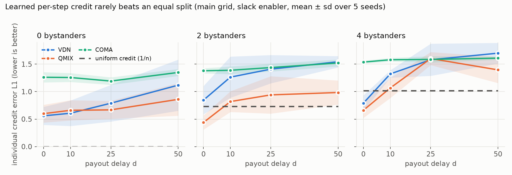
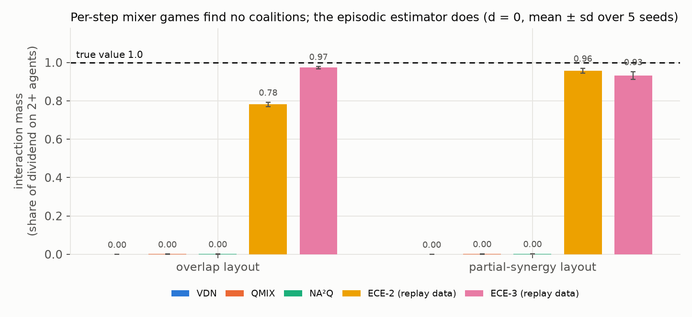
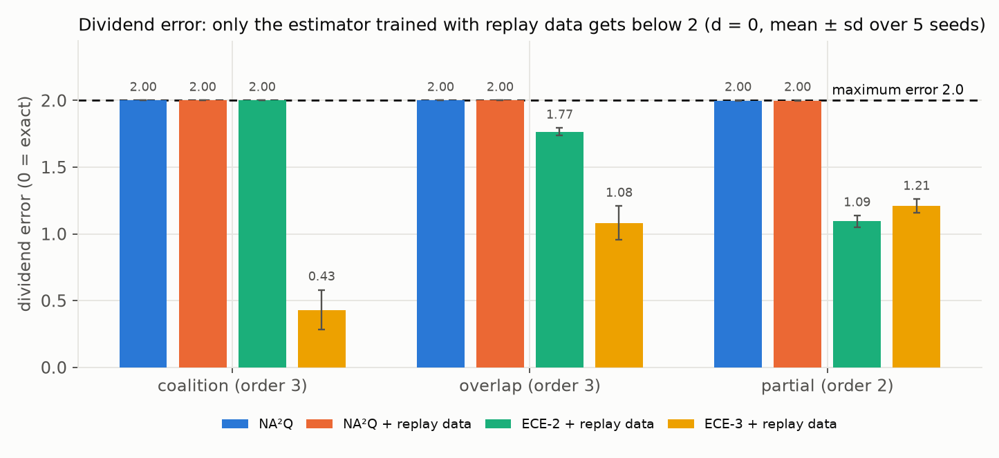
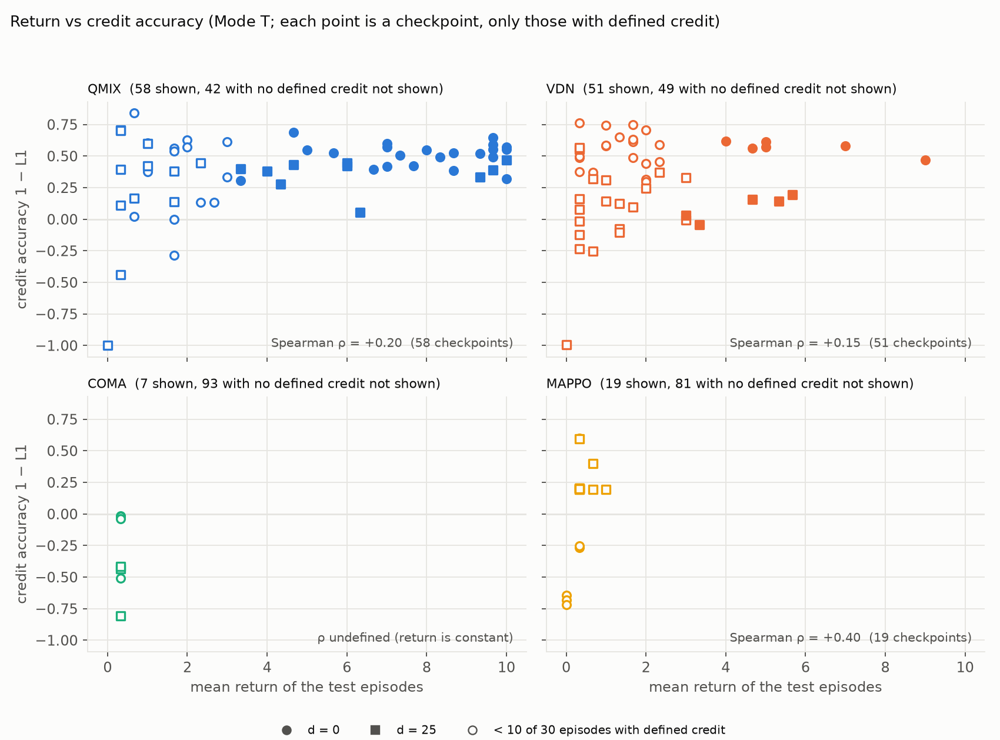

# Who Earned the Reward? Ground-Truth Evaluation of Subgroup Credit Assignment

Draft report, 7 November 2026. Every number is from a document in this repository; the source for each section is named in it. Full results: `docs/results_overview.md`.

## 1. Question

In cooperative multi-agent RL a team often receives one delayed reward for something a *subgroup* did. Credit-assignment methods are judged by the return they reach, not by whether the credit they assign is right. We ask: **when a coalition earns a delayed reward, do standard credit read-outs recover who earned it?** The only way to answer is to know the answer, so the project builds a benchmark with an exact ground truth.

## 2. Benchmark

- **Planted Coalition Gridworld** (`docs/environment_design.md`). Events have enablers and finishers (A pulls a lever, then B and C push together); the reward is paid d steps after completion; bystanders may wander; layouts include overlapping events and partial synergy.
- **Exact truth by true removal.** For each test episode we remove any subset of agents (replaying the episode, or re-running the scripted team), read off the coalition value v(S) for all 2^n subsets, and compute Harsanyi dividends, Shapley values and leave-one-out credit.
- **Metrics.** Individual credit error L1, leakage Λ to bystanders, missed enabler credit M, and, at the coalition level, dividend error, recall/precision and interaction mass.
- **Mode P.** Critics are trained on scripted episodes, so credit can be separated from exploration. Mode T (online training) is covered in §7.

## 3. Per-step credit read-outs (main grid, H0–H2)

120 cells (delay 0–50, 0–4 bystanders, slack or critical enabler, 5 seeds) with VDN, QMIX, COMA and MAPPO (`docs/main_results.md`).

*Figure 1. Individual error against leave-one-out credit, slack enabler. With no bystanders an equal split is exactly right, so the dashed line is at 0. MAPPO is omitted: its shared advantage gives every agent ±1/n by construction.*

- **Credit from per-step read-outs is a different quantity from "who earned the reward".** Even a perfect per-step critic gives a slack enabler essentially zero credit (missed credit 0.99 under the no-op notion in all 12 slack conditions, independent of delay), whereas removal credit gives it a full share.
- **Learned read-outs rarely beat an equal split.** Across the main grid 5 of 96 method-conditions beat uniform credit (4 if MAPPO's artefact is excluded), almost all at d ≤ 10.
- **COMA leaks to bystanders more, not less** (H2′ reversed in 8/8 comparisons). H2 holds for COMA (8/8); VDN and QMIX miss it, although every VDN/QMIX difference has the expected sign (a post-hoc sign test, p = 1.5e-5, indicative only because the conditions share data).
- **Low end-to-end error is not evidence of faithful credit** (H-fid): 30 of the 32 best end-to-end cells have per-step fidelity r < 0.3.
- Pre-registered H0, H1a and H1b are not supported as written (narrowly for H0; H1b because only 54% of "critical" episodes were critical).

## 4. Coalition level (H3)

NA²Q and STAS were reimplemented, and VDN, QMIX and NA²Q were read out as coalition games (`docs/h3_results.md`). Their games are almost purely additive (interaction mass 0.000–0.002 against a true 1.0), because a per-step game cannot represent coalitions whose members act at different times. Dividend error is at its maximum for all of them, so the pre-registered H3 test cannot separate methods and is **uninformative**.

## 5. A coalition estimator (H5)

The episodic coalition estimator (ECE-k) fits an episode-return model with coalition terms up to size k, reads out low-order dividends and splits each among its members. It is trained on episodes plus open-loop replays with random agents removed (`docs/h5_results.md`, pre-registered in `docs/h5_preregistration.md`).

*Figures 2 and 3. Coalition recovery at d = 0 (the results are the same at d = 50).*

- ECE-3 with replay data recovers the order-3 coalition: dividend error **0.43 against 2.00** for NA²Q (with or without the same replay data), recall and precision 0.96. It is significantly better in **8/8** conditions on dividend error and on individual L1 against uniform credit (gain 0.29–0.61).
- **Not supported:** lower leakage (2/8 against NA²Q, 1/8 against data-matched NA²Q). The replay data alone removes most of NA²Q's leakage.
- **The replay data is essential.** Trained on episodes alone, ECE reproduces uniform credit and recovers no coalition.
- **Honesty check.** ECE-2 cannot represent an order-3 coalition (dividend error stays 2.0 on the coalition layout and 1.77 on overlap) although its individual L1 stays close to ECE-3's.
- **Cost.** On one machine ECE-3 is about 3.5× cheaper than NA²Q and STAS with replay data.

## 6. Sensitivity (`docs/sensitivity.md`)

- **Shapley vs leave-one-out.** The two targets differ by L1 ≤ 0.03 on the coalition layout (0.06 on partial, 0.10 on overlap); rankings agree in 27 of 30 conditions and the best method is always the same. No verdict changes.
- **Open- vs closed-loop removal.** The closed-loop truth recovers the planted coalition in 100% of 3,600 test episodes (open loop: 83%; 66% at 4 bystanders), so the H0 failures are an artefact of open-loop replay: **H0 becomes supported** under closed loop (all 120 cells pass; max remove-vs-noop L1 0.000). H1b, H2, H2′ and H-fid are unchanged, but **H1a becomes supported through one QMIX condition** (Holm p 0.074 → 0.030). H1a is therefore borderline, not a robust negative. The pre-registered verdicts stay the open-loop ones; these are sensitivity results.

## 7. Mode T and H4 (return vs credit faithfulness)

Plain online training never earned reward: QMIX and MAPPO for 400k steps and QMIX for 1M steps stayed at return 0, because a uniform-random policy completes the task in 0 of 20,000 episodes. Seeding the replay buffer with 200 scripted episodes lets the off-policy learners (VDN and QMIX) learn, so H4 was assessed for those two (`docs/mode_t_results.md`): 20 runs (delay 0 and 25, 5 seeds), credit scored at every checkpoint. COMA and MAPPO clear their buffers after each update, so seeding does not help them. COMA and MAPPO were also tried, after behavioural-cloning pretraining on scripted episodes; they start at return about 10 but online training collapses them, so credit is defined at only 7 (COMA) and 19 (MAPPO) of 100 checkpoints and H4 cannot be assessed for them. 20 more runs, `docs/mode_t_results.md` §3b.

*Figure 4. Each point is a checkpoint. Hollow markers have fewer than 10 of 30 test episodes with defined credit.*

- **Return is only weakly correlated with credit accuracy within each method:** Spearman ρ = +0.20 for QMIX (95% CI [−0.12, +0.47]) and +0.15 for VDN ([−0.18, +0.34]). No interval reaches the 0.7 we set in advance for "strong", so the clause "return is a weak proxy" is consistent with the data and its falsifying condition is not met.
- **Not shown:** that two methods with indistinguishable return differ in L1. QMIX earns significantly more than VDN (6.5 vs 3.1, p = 0.013) while their L1 barely differs (0.64 vs 0.75, p = 0.44).
- **Post-hoc: against uniform credit.** At the last checkpoint of each run, QMIX's credit beats an equal split: L1 0.64 vs 0.79, in 7 of 10 runs (exact Wilcoxon p = 0.020). VDN's does not: 0.75 vs 0.68, in 4 of 10 runs. So online-trained QMIX carries some information about who earned the reward, unlike most Mode P read-outs (5 of 96 conditions beat uniform there).
- **Descriptive only.** The thresholds are ours (set before scoring), 42–49% of checkpoints have no defined credit (restricting the range of return), and the seeded protocol is not standard online training.

## 8. Limitations

- Mode T assesses only VDN and QMIX, under a seeded replay buffer; COMA and MAPPO could not be assessed.
- One environment family, scripted behaviour data, at most 7 agents and 5 seeds per cell; power is limited, and the pre-registered rules are strict (a family is supported only if every condition passes).
- VDN and QMIX learn Q*; COMA, MAPPO and NA²Q (SARSA) learn the behaviour policy's value.
- ECE with replay data needs the ability to replay episodes with agents removed, a stronger assumption than any compared method makes.
- STAS and NA²Q are our reimplementations. STAS ran on a mix of devices in H5 (laptop GPU, laptop CPU, RTX 4060); it is descriptive there.
- The uniform baseline, the H1b split by criticality, the VDN/QMIX sign test and the sensitivity checks are post-hoc or exploratory and are labelled so in their documents.

## 9. Reproducing

`docs/running_on_another_machine.md` covers environment setup and each grid. Figures: `scripts/make_figures.py` (needs `matplotlib`). Mode T needs a Python 3.12 environment, because `sacred` does not import under 3.14.
