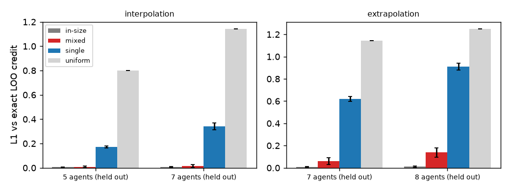
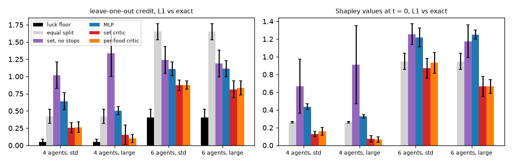
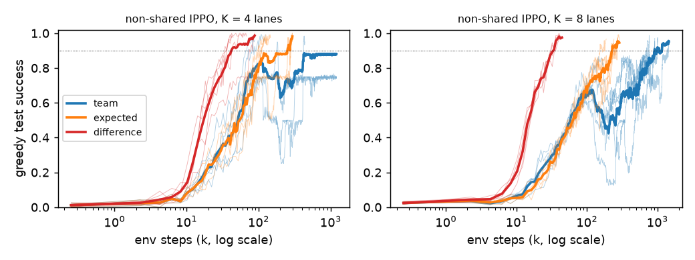

# Who earned the reward? v4 report: the next steps after v3

Team Aporia · 13 Nov 2026 · branch `v4-next-steps` · pre-registrations frozen per part: C `fe679a6`, A `21285a0`, D `fae1df9`, B `e0198de`

> Every number here is generated by `scripts/v4/analyse_v4.py` (verdicts, `results.md`), `scripts/v4/figures.py` and `scripts/v4/lbf_pilot_table.py` from `results/v4/` (A, B, D) and `results/v3/phase3/online_credit` (C; curves exported to `results/v4/online_credit_curves.json`). Confirmatory seeds 10–14 were never used before v4. Pilots used seeds 0–4. Decisions and their reasons: `decisions.md` (E1–E12).

## 0. Summary

v3 ended with three named next steps (`docs/v3/PROGRESS.md`) and one deferred plan item. v4 ran all four, each pre-registered before its confirmatory runs.

| Question | Answer | Evidence |
|---|---|---|
| **A.** Does training the set critic on several team sizes stop credit leaking to bystanders at unseen sizes? | **Yes.** Interpolating to unseen sizes: L1 0.008 / 0.014 (in-size critic 0.006 / 0.008). Extrapolating to larger teams: 0.06 / 0.14, against 0.62 / 0.91 for a data-matched single-size critic. Leakage falls from 9–46% to 0.4–7%. | A1–A5 all supported |
| **B.** Does credit by intervention carry over to Level-Based Foraging, a standard benchmark with a new random layout every episode? | **Yes for 4 agents; partly for 6.** 4 agents: set-critic L1 0.26 at v3's data budget and 0.16 at 4× data, against 0.42 for the equal split (luck floor 0.05). Shapley error 0.13 / 0.07 vs 0.26; the right agents in 99% of layouts. Without stops it fails (1.02–1.34). Not confirmed: that 4× data brings it close to exact (B5) and reliably helps (B6); one seed in five got worse. 6 agents: better than the equal split (0.81–0.87 vs 1.65) but far from exact (floor 0.41). | B1–B6 |
| **C.** Is the learning gain from difference rewards really the removal of *other agents' luck*? | **Partly.** Realised difference rewards are 26× faster than team reward at K = 8 in episodes, and 6.3× faster than expected-value credit, so most of the gain is luck (C2, C3); counting their 17 simulators per step, only 1.6× cheaper. But expected credit is itself 4.2× faster than team reward (C1 not supported). Post-hoc, the curves show where that comes from: not faster learning (same steps to 50% success), but **no late collapse** (max drawdown 0.10–0.25 vs 0.28–0.49). | C1 ✗, C2 ✓, C3 ✓; post-hoc drawdown |
| **D.** Does the set critic's near-exact credit survive random start cells (timing varies per episode)? | **Yes**, with one borderline cell: L1 0.018 (b = 2), 0.030 (b = 4; two of five seeds just above 0.05); per-step r 0.999. MLP 0.52 / 0.96. | D2, D3 ✓; D1 partial |

**Pre-registered tally (seeds 10–14):** 13 supported, 1 partial (D1), 3 not supported (C1, B5, B6), plus descriptive items (C4, 6-agent LBF). Every failure and the one partial result are reported where they occur.

**What changed in the code:**
- multi-size training for the set critic (`critics.fit_set_critic_multi`);
- a deterministic LBF with persistent stops, tested step for step against `lbforaging` (`envs/lbf.py`), a two-set critic (agents × food) and a reward-decomposed per-food critic (`critics.TwoSetCritic`, `FoodHeadCritic`);
- an online expected-credit reward mode for EPyMARL (`epymarl_env.py`, `reward_mode="expected"`);
- random start cells for the coalition layout (`layouts.random_role_starts`).

## 1. Part A: mixed-size training of the set critic

**Why.** v3's set critic, trained at one team size, picked the right coalition at unseen sizes but leaked 14–30% of the credit to bystanders it had never seen in that number (P11). The hypothesis: nothing in single-size training forces an extra bystander's token to contribute zero to the pooled value. Training on several sizes should force it.

**Design** (`scripts/v4/size_mixed.py`; shuffled roles, d = 25, no-op null, 200 episodes + 200 stops per training size). The control is **data-matched**: a single-size critic with the *same total* number of stops (decision E4), so "mixed beats single" cannot be "more data beats less".

| Held-out team size | mixed | single (data-matched) | in-size (trained at that size) | equal split | mixed leakage | single leakage |
|---|---|---|---|---|---|---|
| 5 agents (interp.; trained 4, 6, 8) | **0.008** | 0.173 | 0.006 | 0.800 | 0.4% | 8.6% |
| 7 agents (interp.) | **0.014** | 0.341 | 0.008 | 1.143 | 0.7% | 17.1% |
| 7 agents (extrap.; trained 4, 5, 6) | **0.060** | 0.619 | 0.008 | 1.143 | 3.0% | 31.0% |
| 8 agents (extrap.) | **0.138** | 0.911 | 0.010 | 1.250 | 6.9% | 45.6% |

All five predictions are supported (Holm-corrected one-sided t-tests; `results.md`). Mixed-size training picks exactly the coalition at every held-out size (top-k 1.00).

**Reading.**
- **Between trained sizes, credit at unseen sizes is as good as training at that size.** The leak in v3 was a training artefact, as hypothesised.
- **Beyond the largest trained size, it degrades gracefully**: 0.06 one size out, 0.14 two sizes out, versus 0.62 / 0.91 for single-size training. Extrapolation is still the critic's weak spot, but now it is a small calibration error, not a qualitative failure.
- Practical consequence: a credit critic for teams of varying size should be trained on at least two sizes that bracket the sizes it will see.

## 2. Part B: Level-Based Foraging

**Why.** Everything up to v3 used one hand-built gridworld. LBF (Papoudakis et al., 2021) is a standard benchmark in which every episode has new positions, agent levels and food levels. It is the strongest external-validity test available with exact truth.

**Getting the test right took most of the work, and the failures are informative** (`lbf_design.md`, all on pilot seeds 0–4):
1. Exact truth needs determinism; the package's load order depends on memory addresses. So LBF was re-implemented and tested step for step against `lbforaging` 2.0.0 (E5).
2. The first critic state hid food levels' absolute scale (E6). Fixing it did not help on its own.
3. **No-op truth in LBF mostly measures the planner's blind spot.** Teammates are not told, so the greedy planner keeps assigning the frozen agent; partners wait beside the food forever, and one frozen agent often costs all the food (E7). This is a genuine property of the no-op null with replanning teammates, and a caution for anyone using it on benchmarks: its credit includes the *coordination failures the absence causes*, which can dominate.
4. **Removal truth under the package's food rule is identically zero** for 4 agents: food levels are capped at the sum of the 3 lowest agent levels, so any 3 agents can lift anything (E7).
5. With **heavy food** (the package's `max_food_level` option set to the sum of all levels), *who is pivotal for which food* becomes the credit question, the core LBF mechanic, and the truth is exact, non-degenerate and mostly structural (luck floor 0.03–0.10).

**Confirmatory design** (frozen `e0198de`). Heavy food, removal null, ε = 0.2, 30 test layouts per cell, seeds 10–14, at two data budgets (E10): **std** (v3's: 200 training layouts, 200 stops) and **large** (800 layouts, 800 stops, 6,000 critic steps). The primary method is the two-set critic, pre-specified from v3. The per-food (reward-decomposed) critic is secondary (E9).

| 4 agents (heavy) | LOO L1, std | LOO L1, large | Shapley L1, std | Shapley L1, large | right agents (top-k), large |
|---|---|---|---|---|---|
| luck floor (best possible expected credit) | 0.050 | 0.050 | – | – | – |
| equal split | 0.420 | 0.420 | 0.261 | 0.261 | 0.73 |
| set critic, no stops | 1.020 | 1.337 | 0.668 | 0.911 | 0.78 |
| MLP, stops | 0.641 | 0.504 | 0.437 | 0.327 | 0.84 |
| **set critic, stops** | **0.255** | **0.155** | **0.126** | **0.074** | **0.99** |
| per-food critic, stops (secondary) | 0.263 | 0.099 | 0.158 | 0.067 | 0.99 |

| ID | Prediction (4 agents) | Result | Verdict |
|---|---|---|---|
| B1 | set beats the equal split | std 0.255 vs 0.420; large 0.155 vs 0.420 | **Supported** (p ≤ 0.009) |
| B2 | stops are necessary (gap > 0.30) | gap 0.76 / 1.18 | **Supported** |
| B3 | set beats the MLP (gap > 0.15) | gap 0.39 / 0.35 | **Supported** |
| B4 | Shapley values better than the equal split (gap > 0.05) | gap 0.14 / 0.19 | **Supported** |
| B5 | large budget: L1 < 0.25 | mean 0.155, but per seed 0.07, 0.07, 0.13, **0.40**, 0.10 | **Not supported** (p = 0.10) |
| B6 | more data helps | 0.255 → 0.155; four seeds improved by 0.09–0.27, one got worse (0.25 → 0.40) | **Not supported** (p = 0.12) |

**Reading.**
- **The method carries over.** On a benchmark where every episode is a new task, persistent stops plus a symmetric critic give credit far better than the equal split, an MLP or the same critic without stops, in both leave-one-out and Shapley terms. They also identify the agents that matter in 99% of layouts. Without stops the critic is worse than the equal split, as in v3: the stops, not the architecture, make credit learnable.
- **"Close to exact with data" is not confirmed.** Four of five seeds reach 0.07–0.13 at 4× data, near the luck floor (0.05), but seed 13 got worse. With five seeds, one outlier is enough to sink both tests. We report it as written. On the same data the secondary per-food critic gives 0.099 and is better than the set critic on seed 13 (0.19 vs 0.40), which suggests the outlier is a fit failure, not an unlearnable layout set. That is post-hoc and not a claim.
- **6 agents, 4 foods (descriptive; expectation written before the runs).** The set critic beats the equal split on leave-one-out credit (0.87 std, 0.81 large vs 1.65; floor 0.41) and identifies the right agents in 39% / 57% of layouts (equal split 33%). It is far from exact. The written expectation was that it would *not* beat the equal split on Shapley values. It did, slightly at std (0.87 vs 0.95) and clearly at the large budget (0.67 vs 0.95), so the expectation was too pessimistic. With 2⁶ coalitions and four foods, the remaining error is the open problem LBF leaves.

## 3. Part C: is the learning gain the removal of luck?

**Why.** v3's sharpest learning result (Addendum A2): without parameter sharing, exact difference rewards needed 38× fewer episodes than team reward at K = 8 lanes. v3 theory §7 attributes the gain to *realised* counterfactuals removing other agents' luck, which no expected-value credit can do. Part C tests that with a third arm.

**Arms** (EPyMARL `ippo_ns`, default hyperparameters, K ∈ {4, 8} walled lanes, seeds 10–14):
- **team**: shared reward;
- **difference**: realised difference reward from lockstep shadow copies, which here equals the agent's own lane reward;
- **expected** (new, E3): κ_i = r_t + W₋ᵢ(s_{t+1}) − W₋ᵢ(s_t), with W₋ᵢ the sum of per-lane values of the *other* lanes, each a TD(0) table learned online. It equals *own lane reward + the other lanes' TD errors*. With exact tables it is exact expected-value ablation credit, and it differs from `difference` by exactly the other lanes' luck.

| K | team | expected | difference | expected / team | difference / expected | difference / team |
|---|---|---|---|---|---|---|
| 4 | 21,734 (2 of 5 never reached 90%) | 6,714 | 1,802 | 0.57 (geo. mean) | 0.29 | 0.16 |
| 8 | 36,506 | 8,506 | 1,338 | **0.24** | **0.16** | **0.04** |

Episodes to 90% greedy test success (mean of 5 seeds); ratios are geometric means of per-seed ratios, the quantity tested.

| ID | Prediction (K = 8) | Result | Verdict |
|---|---|---|---|
| C1 | expected / team > 0.5 (expected credit not more than 2× faster) | 0.24, p = 0.996 | **Not supported** |
| C2 | difference / expected < 0.2 | 0.16, p = 0.017 | **Supported** |
| C3 | difference / team < 0.2 (replicates v3 A2 on new seeds) | 0.04, p = 0.0001 | **Supported** (26× faster) |

**Reading.**
- **Removing other agents' luck is the larger effect** (C2): even against the expected-credit arm, realised credit is another 6.3× faster at K = 8. That is the part theory §7 predicted, and only a realised counterfactual delivers it.
- **But expected credit is not inert** (C1 fails). The pre-registered reading of that outcome was "better baselines matter, so §7's practical claim is wrong for non-shared IPPO". The mechanism is the theory's assumption: §7's equivalence holds for a critic that conditions on the *full* state. `ippo_ns`'s critics see only their own agent's observation, with 5-step bootstrapped targets. From agent i's point of view, the other lanes' rewards split (law of total variance) into a part predictable from those lanes' state (their mean, which drifts as their policies learn) and their luck. A local critic can model neither. Expected credit removes the first: the other lanes' TD errors are zero-mean given their state. Difference rewards remove both.
- **Post-hoc (E12): where the expected arm's gain comes from.** In the learning curves, team and expected learn at the *same* speed early (steps to 50% success at K = 8: 59k vs 60k; difference 15k). The difference comes later. Team-reward runs repeatedly collapse after reaching 60–70% success, as the other lanes' changing success rates shift each agent's return, while expected-credit runs do not.

  | K = 8, max drawdown after first reaching 50% success (per seed) | |
  |---|---|
  | team | 0.49, 0.37, 0.28, 0.29, 0.35 |
  | expected | 0.13, 0.25, 0.12, 0.10, 0.12 |
  | difference | 0.02, 0.12, 0.03, 0.03, 0.11 |

  So the three-way decomposition is: the drift of other agents' *expected* outcomes destabilises learning late, and a centralised expected credit removes it; other agents' *luck* slows learning throughout, and only realised credit removes it. Measured after seeing the curves, so labelled post-hoc.
- **Simulator cost (added after the external review; `docs/v5/cost_accounting.md`).** Difference rewards step 2K + 1 = 17 simulators at K = 8, expected credit only one. Counted in simulator episodes to 90% success: difference 0.64× team, expected **0.24× team**. Per unit of simulation, the expected-credit arm is the most efficient of the three, and it needs no resettable simulator. It does use the lane decomposition (one value table per lane), which a learned ablation critic would have to replace.
- **Consequence for the project's learning claim.** "Who earned the reward" matters for learning in two separable ways. Expected credit is a form of centralised-critic information passed to decentralised learners, the CTDE idea. Realised credit additionally needs counterfactual access (a simulator or shadow copies), which is what difference rewards assume.

## 4. Part D: random start cells

**Why.** Deferred v3 plan item 2.5. v3 had judged it a weaker variant of shuffled roles. That was wrong, more so than this section first said. Shuffled roles move start cells *with* the roles, so a shuffled episode is a relabelling of a fixed one, and a permutation-invariant critic sees literally the same input (v3 errata E12, found by an external review and verified in `tests/test_review_v5.py`). So the moment the lever is pulled, and *when* a stop stops mattering, was the same in every episode. **Part D is the first genuine test of the set critic on configurations it has not seen.** Random start cells vary that timing per episode (E8). Bystanders stay off the coalition's routes, as with the fixed slots, so their true credit stays zero.

| Method | L1 (b = 2) | L1 (b = 4) | step r (b = 2) | step r (b = 4) |
|---|---|---|---|---|
| equal split | 0.800 | 1.143 | – | – |
| MLP, no stops | 1.035 | 1.205 | 0.06 | 0.06 |
| MLP, 200 stops | 0.524 | 0.957 | 0.74 | 0.47 |
| MLP, 800 stops | 0.214 | 0.580 | 0.94 | 0.76 |
| **set critic, 200 stops** | **0.018** | **0.030** | **0.999** | **0.999** |
| set critic, structural read-out | 0.019 | 0.020 | 0.999 | 0.999 |
| set critic, 800 stops | 0.007 | 0.016 | 1.000 | 1.000 |
| presence table (order 3) | 0.801 | 1.150 | – | – |

- **D2, D3 supported; D1 partial.** At b = 4 the mean (0.030) is below the 0.05 threshold but two of five seeds are just above it (0.074, 0.051), so the one-sided test is not significant (p = 0.11). The structural read-out of the same critic gives 0.020, and 800 stops give 0.016.
- The numbers are close to v3's shuffled-roles result (P8: 0.010 / 0.008), which was a fixed-layout result in disguise (E12). So new geometry and timing cost the set critic almost nothing. The per-step credit, the quantity that depends on timing, stays at r = 0.999.
- The MLP, as before, does not generalise across configurations; its gap to the set critic grows with team size.

## 5. Limits

- **One scripted team per environment.** Truth is exact *for that team*. Credit for a learned team would need its policy frozen during truth computation, as in v3 Phase 4.
- **LBF results hold for the heavy-food variant under the removal null.** Under the package's default food rule, removal credit is degenerate; under the no-op null, credit is dominated by planner deadlock. Both are reported, not hidden.
- **Part C uses tabular per-lane values.** That is exact here because the lanes are independent and small. With interacting agents, expected credit needs a learned ablation critic, so the measured gain is an upper bound on what a learned W₋ᵢ would give.
- **Five seeds per cell.** Effects are large relative to seed variance except where noted (B1 at the standard budget, D1 at b = 4).

## 6. What to claim, and what not

Claim:
- Mixed-size training removes the size-transfer leak (A).
- On random-layout LBF with 4 agents, credit by intervention is learnable: far better than the equal split, the MLP or no stops (0.26 → 0.16 with 4× data, luck floor 0.05; the approach to the floor is not confirmed, see B5–B6).
- The learning gain of difference rewards is mostly the removal of other agents' luck; expected-value credit gives a smaller, different benefit (stability), because decentralised critics cannot condition on others' state (C, partly post-hoc).
- Set-critic credit is robust to random geometry (D).

Do not claim:
- that LBF credit is solved for larger teams (6 agents: see B);
- that the no-op null is the right null for benchmarks with replanning teammates;
- that expected credit would help a learner with a centralised critic (MAPPO); Part C tested decentralised critics only.

## 7. Plan items and next steps

All four v3 next steps are done. Natural follow-ups:
- (i) LBF with a **learned** team (freeze an EPyMARL policy, compute truth for it);
- (ii) the 6-agent LBF gap: whether it is capacity (deeper attention) or data;
- (iii) Part C with a **centralised** critic (MAPPO) to test the other half of §7's claim directly.
