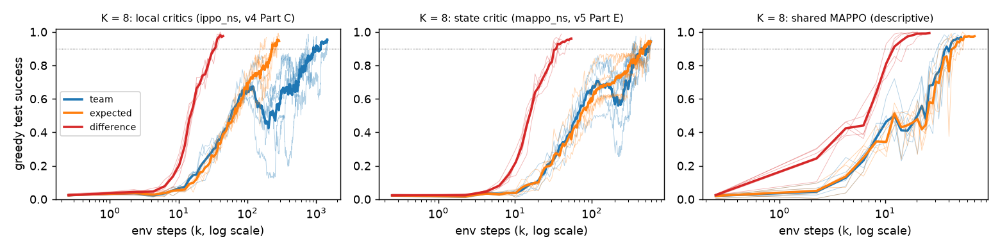
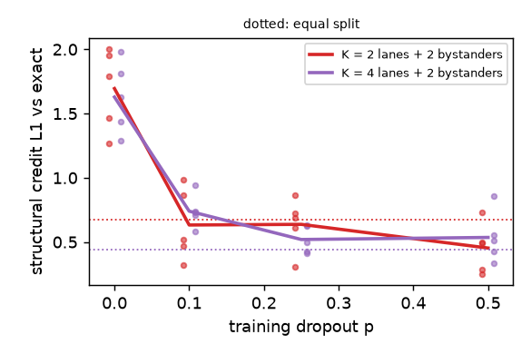

# Response to the external review (14 Nov 2026)

The review assessed the v3 state of the repository. Every point was checked against the code and the stored results before responding. Where the reviewer is right, the record is corrected (v3 `errata.md` E11–E15, with a corrections box at the top of `docs/v3/report.md`). Where work was missing, it was done: in v4 (13 Nov) or in v5 (new runs, pre-registered in `preregistration_v5.md` before they started).

**Summary.**
- Four of the five "left out" items are now done; the fifth (robustness) is measured, and the test is shown to have no headroom in these layouts.
- All four "problems" are confirmed and corrected.
- The three results the reviewer called meaningful are unaffected by any correction.
- New runs:
  - **MAPPO arm:** with a state critic, expected-value credit gives exactly nothing (1.05× team), as theory §7 predicts. Realised difference rewards are 12× faster in episodes, but 1.4× more expensive in simulation.
  - **Phase 4, extended:** dropout repairs MAPPO's critic but does not beat an equal split. Credit "for free" from robustness training is not supported.

## What was left out

| Review point | Status | Where |
|---|---|---|
| Raw results not on GitHub (`results/v3/` git-ignored) | **Fixed.** All 1,508 result files are published gzipped, lossless (418 MB → 27 MB; checkpoints and Sacred source copies excluded; round trip verified byte for byte). `scripts/v5/restore_results.py results/v3` restores them, after which every v3 analysis script runs unchanged. v4 results were already committed. | E15; `scripts/v5/export_results.py` |
| No second environment (LBF, plan 4.4) | **Done in v4 Part B.** Deterministic LBF, tested step for step against `lbforaging` 2.0.0; random layouts every episode; exact truth. With 4 agents, credit is learnable: L1 0.26 / 0.16 (two data budgets) vs 0.42 for the equal split; Shapley error halved; the right agents in 99% of layouts. The claim of near-exactness with more data was *not* confirmed (B5, B6). 6 agents: far from exact. | `docs/v4/report.md` §2, `docs/v4/lbf_design.md` |
| Randomised start cells (plan 2.5) skipped, with a reason that doesn't hold | **Done in v4 Part D**, and the reviewer's critique of the reason was even sharper than v4 assumed (problem 2 below). Set critic L1 0.018 / 0.030 on unseen geometry, per-step r 0.999; MLP 0.52 / 0.96. D1 partial (b = 4: two of five seeds just above 0.05). | `docs/v4/report.md` §4 |
| Phase 3: no MAPPO arm; simulator cost not reported | **Cost: reported** (problem 3 below). **MAPPO arm: run in v5 Part E** (below). | `docs/v5/cost_accounting.md`, `results.md` |
| Phase 4: one dropout level, one layout, 3 seeds; robustness not measured | **Extended in v5 Part F**: 4 dropout levels × 2 layouts × 5 fresh seeds, plus a new robustness metric, the collateral damage of an absence. | below |

## Problems found

**1. MAPPO's "2.00" is an artifact. Confirmed (E11).** In every d ≤ 25 test episode, MAPPO's standard read-out gives every agent about −1/n of the credit: an equal split with the wrong sign, which scores the maximum L1 of 2. Against the equal split, the masked read-out of the same critic is better in all six main conditions (p < 0.001), but by 0.42–0.52 at d ≤ 25 and 0.27–0.29 at d = 50. That is below the pre-registered 0.5 margin in five of six conditions. The direction holds; "2.00 → 0.32" overstated it. The same artifact makes P9c ("data alone does not fix one-step read-outs") hold by construction at d ≤ 25. Regression test: `tests/test_review_v5.py`.

| main grid, closed-loop no-op truth | equal split | MAPPO standard | masked read-out | margin over equal split | share of episodes at L1 = 2.00 (standard) |
|---|---|---|---|---|---|
| d = 0, b = 2 | 0.800 | 2.000 | 0.382 | 0.418 | 100% |
| d = 0, b = 4 | 1.143 | 2.000 | 0.686 | 0.457 | 100% |
| d = 25, b = 2 | 0.800 | 2.000 | 0.380 | 0.420 | 100% |
| d = 25, b = 4 | 1.143 | 2.000 | 0.625 | 0.517 | 100% |
| d = 50, b = 2 | 0.800 | 1.614 | 0.533 | 0.267 | 57% |
| d = 50, b = 4 | 1.143 | 1.945 | 0.853 | 0.290 | 89% |

**2. The shuffled-roles result is guaranteed by design. Confirmed (E12).**
- Start cells move with roles, so a shuffled-roles state is a relabelling of the fixed-layout state. A permutation-invariant critic returns the same value for any weights; verified for 30 episodes, with and without role flags, also after stops (`tests/test_review_v5.py`).
- P8a/b/c-a/d (and P7a) therefore show that the invariance is implemented correctly and that the MLP needs far more data. They are not evidence of generalisation.
- Genuine generalisation tests, all done in v4:
  - **random start cells** (Part D): new geometry and timing; the set critic stays near exact;
  - **unseen team sizes** (Part A): v3's 14–30% leak was a training artefact. Mixed-size training brings it to 0.4–7%, with L1 0.008–0.014 between trained sizes and 0.06–0.14 beyond them;
  - **random LBF layouts** (Part B): partly.

**3. The learning speed-up needs 17 simulator copies at K = 8. Confirmed (E13), and the pre-registration had promised this cost.**

| K = 8, simulator episodes to 90% success, relative to team reward | episodes ratio | simulators per step | cost ratio |
|---|---|---|---|
| difference, shared parameters (v3 gate) | 0.40 | 17 | **6.75** |
| difference, no sharing (v3 addendum A2) | 0.030 | 17 | **0.52** |
| difference, no sharing (v4 Part C, new seeds) | 0.038 | 17 | **0.64** |
| expected-value credit, no sharing (v4 Part C) | 0.24 | 1 | **0.24** |

We agree with the reviewer's reading: exact difference rewards here reproduce Wolpert & Tumer and need a resettable simulator. One point the review could not have seen: v4's expected-value credit needs no shadow copies and is the cheapest arm per unit of simulation (it does use the lane decomposition). v5 Part E tests whether its benefit survives a centralised critic.

**4. "18 of 28 supported" is a replication check. Agreed (E14).** Seeds 5–9 re-draw noise on the same layouts. Five of the 18 hold by construction (P7a, P8a, P8b, P8c-a, P8d), and P9a's margin was inflated. The substantive confirmatory content is P2–P4 and P6a, P5, P10 and P11. v4 and v5 use designs where the confirmatory runs face *new configurations* (unseen sizes, geometry, layouts) and say which predictions are descriptive.

## The three results the reviewer found meaningful

None is affected by the corrections:
- **Credit needs interventions.** v4 replicates it on unseen geometry (Part D: no-stops critic 1.04 / 1.21) and on LBF (B2: no stops 1.02 / 1.34 vs 0.26 / 0.16).
- **H5 was about the data.**
- **Parameter sharing hides most of the benefit of exact credit.** Now with the cost attached (problem 3), and with v5 Part E as its MAPPO counterpart.

## New runs (v5, pre-registered at `0ab52d7` before they started)

Full tables: `results.md` (generated by `scripts/v5/analyse_v5.py`). Pre-registered predictions: **5 supported (E1, E2, E3, F1, F3), 1 not supported (F2), and 1 descriptive expectation not met (F4)**.

### Part E: the learning question with MAPPO

`mappo_ns` is v4 Part C's `ippo_ns` with **only the critic changed** (it sees the global state). Same seeds, budgets, arms.

| K = 8, episodes to 90% (geo. mean ratio vs team) | local critics (`ippo_ns`, v4) | state critic (`mappo_ns`, v5) | shared MAPPO (descriptive) |
|---|---|---|---|
| team reward (mean episodes) | 36,506 | 17,338 | 1,498 |
| expected-value credit | **0.24** | **1.05** | 1.13 |
| realised difference rewards | 0.038 | 0.083 | 0.35 |
| difference, counted in simulator episodes (×17) | 0.64 | **1.42** | **5.90** |

- **E1 supported** (expected/team = 1.05 > 0.5, p = 0.001), **E2 supported** (difference/team = 0.083, p = 0.0002), **E3 supported** (1.05 vs 0.24, Welch p < 0.0001).
- **Theory §7 holds exactly when its assumption holds.** With a critic that sees the state, expected-value credit adds nothing to team reward. v4's 4.2× gain with local critics was the information a local critic lacks. A state critic alone halves team reward's episodes (0.48×), most of the way to what expected credit gave.
- **Realised credit still speeds learning 12× in episodes**, which is the removal of other agents' luck. Counting the 17 simulators, it costs 1.4× team reward's simulation with a state critic and 5.9× with shared MAPPO. The reviewer's reading is confirmed: as a training method, exact difference rewards pay off in simulation only for decentralised critics without parameter sharing.
- Descriptive: even with a state critic, expected credit reduces late drawdowns (0.06–0.15 vs 0.13–0.34 at K = 8) without reaching 90% sooner. That matches v4's post-hoc observation.

### Part F: Phase 4 extended (4 dropout levels × 2 layouts × 5 fresh seeds)

| | K = 2, p = 0 | K = 2, p = 0.1 / 0.25 / 0.5 | K = 4, p = 0 | K = 4, p = 0.1 / 0.25 / 0.5 |
|---|---|---|---|---|
| structural credit L1 | 1.70 | 0.63 / 0.64 / 0.45 | 1.63 | 0.74 / 0.52 / 0.54 |
| equal split L1 | 0.68 | 0.67 | 0.47 | 0.43 |
| κ read-out L1 | 0.68 | 0.66–0.67 | 0.47 | 0.42–0.44 |
| clean success | 0.99 | 0.99–1.00 | 0.98 | 0.98–0.99 |
| collateral damage of an absence (share of other events' return) | 0.6% | 0.1–0.8% | 1.2% | 0.0–0.8% |

- **F1 supported** (6/6): every dropout level improves the critic's credit over no dropout (by 0.89–1.24).
- **F2 not supported** (0/2): even with dropout the structural read-out does **not** beat the equal split (K = 2: 0.64 vs 0.67; K = 4: 0.52 vs 0.42).
- **F3 supported**: robustness training costs no return (success ≥ 0.99 at p = 0.5).
- So dropout repairs a critic that, without stops, extrapolates arbitrarily (1.6–1.7, worse than an equal split). It does **not** produce usable credit "for free" in these layouts. That weakens v3's Phase 4 reading (0.43–0.74 on 3 seeds, "partly"). With 5 seeds and a second layout, the honest answer is no; credit needs stop-based Monte-Carlo training (§4 of the v3 report: 0.01–0.06).
- **Robustness to absences (F4, descriptive).** The expectation "below 5% in every run" was not met in one run (K = 4, seed 13, no dropout: 8.3%; that seed's dropout runs: 2.7%, 1.8%, 0.1%). In the other 39 runs it lies between −1.6% and +3.3%, with and without dropout. Walled lanes give an absence almost no way to hurt other events, so these layouts cannot show a robustness benefit. A real test needs substitutable roles (another agent can take over), e.g. LBF with a learned team; we list it as the next step rather than claim it.

